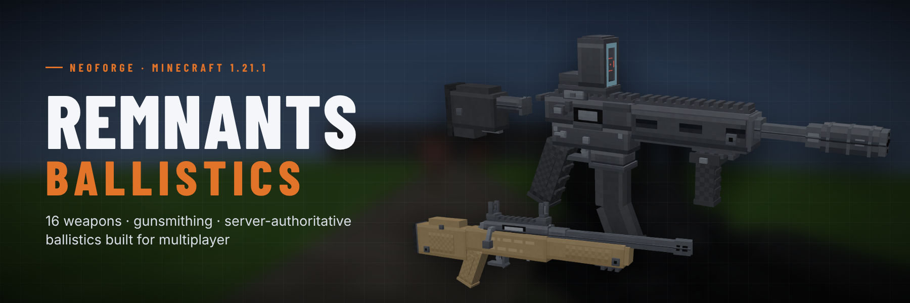

# Remnants: Ballistics

A firearms mod for Minecraft built for multiplayer: sixteen hand-modelled weapons, a server-authoritative ballistics engine, gunsmithing with real trade-offs, and first-person handling that feels like a modern shooter.



## Features

- **16 weapons in 7 classes:** pistols, a revolver, SMGs, assault rifles, shotguns, bolt-action and anti-materiel snipers, LMGs, and two experimental energy weapons. Each has its own stats, fire modes, sound profile, rarity, durability and crafting tier. See [docs/WEAPONS.md](docs/WEAPONS.md).
- **Shooting that holds up online:**
  - Server-validated hitscan with bullet drop, damage falloff and head, body and leg zones.
  - Penetration through soft blocks, shallow-angle ricochets and glass that shatters.
  - Lag-compensated hitboxes and a shared spread seed, so what you see is what the server scores.
- **Handling:**
  - Aim-down-sights with true sight alignment; hip fire and ADS accuracy.
  - Movement, crouch and jump penalties; bloom, recoil and recovery.
  - Weapon sway and bob, fire-mode switching, tactical and empty reloads, single-round loading, pump and bolt cycling, and a charged railgun.
- **Gunsmithing:** a Gunsmith Workbench with optic, muzzle, underbarrel, magazine, stock and skin slots. A live stat preview shows every attachment's trade-offs before you commit. See [docs/ATTACHMENTS.md](docs/ATTACHMENTS.md).
- **Presentation:**
  - Voxel weapons built from up to 118 elements each, with crisp 32×32 icons.
  - First-person viewmodels with per-weapon keyframed animations: equip, idle, inspect, fire, reloads, pump and bolt cycling, charge.
  - Animated muzzle flashes, tracers, per-material impacts, bullet holes, ejected brass and shells, hit markers.
  - 59 sound events: real-recording style gunshots and handling sounds made with [ElevenLabs](https://elevenlabs.io), synthesized impacts, UI and energy weapons.
- **Progression:** steel and brass, an ammunition press, gun parts and precision parts, blueprints found in structures, remnant alloy and void cores. Loot is injected into 25 vanilla structure and mob tables.
- **Configurable:** client visuals, HUD and accessibility; common recipe and loot toggles; server balance, hit zones, anti-cheat tolerances and per-weapon overrides. See [docs/CONFIG.md](docs/CONFIG.md).

## Supported versions

| Workspace | Minecraft | Loaders | Java |
| --- | --- | --- | --- |
| `1.21.1/` | 1.21.1 | NeoForge 21.1.264+, Fabric (Loader 0.16.14+) | 21 |
| `26.2/` | 26.2 | NeoForge 26.2.0.93+, Fabric (Loader 0.19.5+) | 25 |
| `26.3/` | 26.3 | NeoForge 26.3.0.99+, Fabric (Loader 0.19.5+) | 25 |

Each version folder is an independent Gradle project with `common`, `fabric` and `neoforge` subprojects, like the other NightBeam mods: gameplay, rendering, assets and data live in `common`, and each loader project only adds its entry points, registration, networking and event hooks. The release version is `0.5.0` (`version=` in each workspace's `gradle.properties`; `./gradlew syncVersion -PmodVersion=x.y.z` sets all of them). See [the release notes](patchnotes/0.5.0.md).

## Requirements

- JDK 21 to build `1.21.1/`, JDK 25 to build `26.2/` and `26.3/`
- Minecraft 1.21.1, 26.2 or 26.3 with either:
  - **NeoForge** (21.1.264+ on 1.21.1, 26.2.0.93+ on 26.2, 26.3.0.99+ on 26.3; no other mods required), or
  - **Fabric** Loader (0.16.14+ on 1.21.1, 0.19.5+ on 26.x) with [Fabric API](https://modrinth.com/mod/fabric-api) and [Forge Config API Port](https://modrinth.com/mod/forge-config-api-port) (21.1.6+, 26.2.1+ or 26.3.1+). [Mod Menu](https://modrinth.com/mod/modmenu) is optional and opens the config screen.
- Install on **both the server and every client**.

## Build

From a workspace (`1.21.1`, `26.2` or `26.3`):

```
cd 26.3
./gradlew build                                              # Fabric and NeoForge jars + unit tests
./gradlew :neoforge:runGameTestServer :fabric:runGameTestServer  # in-game GameTests on headless servers
```

From the repository root:

```
./gradlew buildAll              # checks the generated assets, builds every workspace, copies jars to releases/
./gradlew gameTestAll           # GameTests of every workspace on both loaders
```

The release jars are `<game>/neoforge/build/libs/remnants_ballistics-neoforge-<game>-<version>.jar` and `<game>/fabric/build/libs/remnants_ballistics-fabric-<game>-<version>.jar`, one pair per workspace.

## Run

```
cd 26.3                         # or 1.21.1, 26.2
./gradlew :neoforge:runClient   # development client (or :fabric:runClient)
./gradlew :neoforge:runServer   # dedicated server (or :fabric:runServer; set online-mode=false in server.properties for dev clients)
./gradlew :neoforge:runClient2  # second client "Dev2" for two-player testing
```

See [docs/MULTIPLAYER_TESTING.md](docs/MULTIPLAYER_TESTING.md) for latency and packet-loss testing.

## Controls

| Action | Default |
| --- | --- |
| Fire | Left mouse (Attack) |
| Aim down sights | Right mouse (Use), hold or toggle |
| Reload | `R` |
| Switch fire mode | `V` |
| Inspect weapon | `I` |

Charge the Eclipse Railgun by holding fire. See [docs/CONTROLS.md](docs/CONTROLS.md).

## Assets

Every model, texture, icon, animation, sound, GUI and data file is generated from source by the scripts in [`tools/assets`](tools/assets) into `1.21.1/common/src/main/resources`, shared by both loaders, and ported to the 26.x formats in `26.2/` and `26.3/` by `tools/assets/port_resources.py`. All assets are original; the firearm sounds are generated with ElevenLabs. The asset set is cross-checked against the Java registries:

```
python3 tools/assets/generate.py        # regenerate everything (needs Python 3, numpy, Pillow and ffmpeg)
python3 tools/assets/port_resources.py  # only re-port to 26.2/26.3 (standard library only; generate.py runs it)
python3 tools/assets/check_assets.py    # validate (also run by ./gradlew buildAll)
```

Weapon models also export to `tools/assets/blockbench/` for editing in Blockbench. See [docs/ASSET_PIPELINE.md](docs/ASSET_PIPELINE.md) and the [asset manifest](docs/ASSET_MANIFEST.md).

## Documentation

- [Feature list](docs/FEATURES.md)
- [Weapons](docs/WEAPONS.md)
- [Attachments](docs/ATTACHMENTS.md)
- [Crafting and progression](docs/PROGRESSION.md)
- [Configuration](docs/CONFIG.md)
- [Controls](docs/CONTROLS.md)
- [Architecture](docs/ARCHITECTURE.md)
- [Multiplayer testing](docs/MULTIPLAYER_TESTING.md)
- [Known limitations](docs/KNOWN_LIMITATIONS.md)
- [Changelog](CHANGELOG.md)

## Contributing

See [CONTRIBUTING.md](CONTRIBUTING.md) and [CODE_OF_CONDUCT.md](CODE_OF_CONDUCT.md).

## Security

See [.github/SECURITY.md](.github/SECURITY.md).

## License

Licensed under the Apache License, Version 2.0. See [LICENSE](LICENSE) and [NOTICE](NOTICE).
